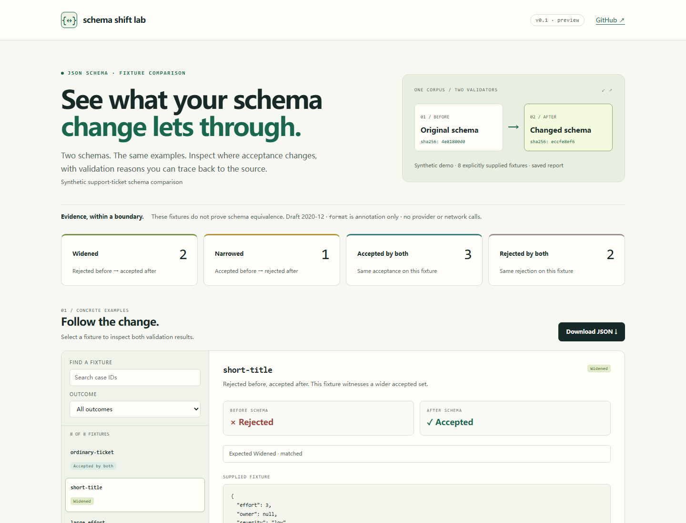

# Schema Shift Lab

[](https://github.com/7364588/schema-shift-lab/actions/workflows/tests.yml)
[Live demo](https://7364588.github.io/schema-shift-lab/) · [Releases](https://github.com/7364588/schema-shift-lab/releases)

Compare two JSON Schema files against the same explicit fixture corpus. Find
concrete examples that one schema accepts and the other rejects, inspect each
validator error and JSON Pointer, and keep expected outcomes as a CI check.

Version 0.1.0 is an initial prerelease with the explicit validation boundary below.

Use it when reviewing a schema migration or comparing an application's original
schema with an explicitly captured effective schema. The tool does not execute
SDKs or adapters, contact providers, or infer what a provider enforces.

**No differences in a finite corpus does not prove schema equivalence.**
**`format` is annotation only: email, date and other formats are not validated.**
Reports contain the supplied schemas and fixture values; they are not redacted.



## Install

Node.js 22 or 24 is supported. This project is distributed through GitHub
Releases; it is **not published on npm**. Install the tested release tarball into
a project:

```sh
npm install --ignore-scripts https://github.com/7364588/schema-shift-lab/releases/download/v0.1.0/schema-shift-lab-0.1.0.tgz
npx --no-install schema-shift-lab --help
```

The package has a pinned Ajv runtime dependency. Installation can contact the
npm registry for dependencies; comparison and generated reports work offline.

To run the included synthetic example from a source checkout:

```sh
git clone https://github.com/7364588/schema-shift-lab.git
cd schema-shift-lab
npm ci --ignore-scripts
npm run build
node src/cli.js compare --before examples/support-ticket/before.schema.json --after examples/support-ticket/after.schema.json --corpus examples/support-ticket/corpus.json --html ticket-report.html
```

This example exits **1**, because its corpus deliberately contains widened and
narrowed cases. Open `ticket-report.html` locally. Run the same fixtures as an
expectation check to get exit **0**:

```sh
node src/cli.js check --before examples/support-ticket/before.schema.json --after examples/support-ticket/after.schema.json --corpus examples/support-ticket/corpus.json --json ticket-check.json
```

Output files must be new. Existing files, directories and symlink destinations
are preserved. Use a different report filename for each run.

## Compare and check

Both modes validate the same nonempty corpus under two independent validator
instances with the same options. They never generate new fixtures.

| Mode | Exit 0 | Exit 1 | Exit 2 |
| --- | --- | --- | --- |
| `compare` | No widened or narrowed case observed | At least one witnessed change | Invalid input, unsupported schema or I/O failure |
| `check` | Every case matches its explicit `expect` | At least one expectation mismatch | Missing expectations, invalid input or I/O failure |

Both modes exit **3** for incomplete worker execution, including a deadline or
resource failure. Unknown results never count as agreement or matched expectations.

An observed change can be intentional. `check` records that intention without
pretending the migration accepts the same set of possible values.

| Outcome | Before | After |
| --- | --- | --- |
| `accepted-both` | accepts | accepts |
| `rejected-both` | rejects | rejects |
| `widened` | rejects | accepts |
| `narrowed` | accepts | rejects |
| `unknown` | Validation did not complete | Never interpreted as agreement |

`--format json` writes the report to stdout instead of the compact text summary.
`--json new.json` and `--html new.html` create report files. `--timeout-ms` sets a
bounded execution deadline. Run `--help` for its accepted range.

## Corpus

Supply one UTF-8 JSON object, not JSONL:

```json
{
  "cases": [
    {"id": "ordinary", "value": {"title": "Printer jam"}, "expect": "accepted-both"},
    {"id": "missing-title", "value": {}, "expect": "narrowed"}
  ]
}
```

IDs must be unique. The corpus must contain at least one case. In `compare`,
`expect` is optional; in `check`, every case needs one of the four concrete
outcomes above. `unknown` is not a valid passing expectation.

Fixtures should target the changed constraints, not only ordinary successful
requests. The support-ticket example includes removed string/numeric bounds,
a newly required nullable field, wrong types, a local `$ref` with composition,
and a deliberately invalid email accepted under the annotation-only policy.

## Validation scope

- Draft 2020-12 only. If `$schema` is absent, this dialect is recorded explicitly.
- Real Ajv validation with no coercion, defaults, property removal or mutation.
- Local root JSON Pointer `$ref` references; no remote fetching, file resolution,
  executable adapters or user-defined keyword code.
- Unsupported dialects, keywords and reference forms fail explicitly. Keywords
  inside `const`, `default` or other instance data are not treated as schemas.
- Schema-map keys named `__proto__` are rejected because the selected validator
  does not reliably preserve their semantics. Instance data can still contain
  that ordinary JSON key; this is a schema boundary, not a data-key rewrite.
- Numeric values use JavaScript binary64 semantics. Unsafe integers, non-finite
  values and duplicate JSON object keys are rejected; decimal arithmetic is not
  arbitrary precision.
- Structural additions, removals and replacements are displayed separately from
  observed validation outcomes. A structural change is not proof of a semantic
  change, and an error pointer is not proof of a sole causal change.

Compilation and validation run in a worker with a deadline and V8 heap limit.
This bounds common pathological schema/regular-expression work; it is not an OS
sandbox or a guarantee against every resource-exhaustion attack. See
[SECURITY.md](SECURITY.md) and the precise API/limits in [docs/usage.md](docs/usage.md).

## Reproducible evidence

Reports record canonical input SHA-256 hashes, validator/options, individual
validity results and pointers. Canonical hashes identify parsed JSON content,
not raw file bytes or signatures. The report contains input values for review;
check it before sharing. The HTML has no remote assets or network requests and
offers local filtering and JSON download. Local filenames and filesystem errors
are not copied into diagnostic messages.

## Related tools and references

- [schema-parity](https://github.com/tamerkalla/schema-parity) already provides
  differential witnesses and generated mutations through caller-supplied
  predicates. Use it to compare executable runtime validators. Schema Shift Lab
  accepts two schema documents and an explicit corpus without loading adapters.
- [Sentry json-schema-diff](https://github.com/getsentry/json-schema-diff) provides
  best-effort structural comparison for Draft 7. Its own documentation explains
  that its breaking-change indications are suggestive.
- [Atlassian json-schema-diff](https://bitbucket.org/atlassian/json-schema-diff)
  is another existing schema diff CLI/library. Evaluate it when a schema-only
  diff is the desired workflow.
- [Bowtie](https://docs.bowtie.report/en/stable/) compares JSON Schema validator
  implementations. This tool compares schemas under one explicit validator.
- [Claude SDK transformation documentation](https://platform.claude.com/docs/en/build-with-claude/structured-outputs#how-sdk-transformation-works)
  describes why an original schema and a transmitted schema may differ. Obtain
  those artifacts yourself; this tool does not capture or verify requests.
- [JSON Schema 2020-12 validation](https://json-schema.org/draft/2020-12/json-schema-validation)
  and [Ajv formats](https://ajv.js.org/guide/formats.html) describe the distinction
  between format annotations and format assertions.

## Development

```sh
npm ci --ignore-scripts
npm run build
npm test
npm run demo
npm run smoke
npm run verify-package
npm audit --omit=dev
```

`verify-package` packs a real tarball, installs it in a fresh directory with
lifecycle scripts disabled, and runs the installed API, CLI, worker and HTML
resource checks. `demo` regenerates the synthetic Pages report deterministically.
CI tests Node 22/24 on Ubuntu and Windows. There are no scheduled workflows or
Dependabot updates. Maintenance is manual; see [MAINTENANCE.md](MAINTENANCE.md).
